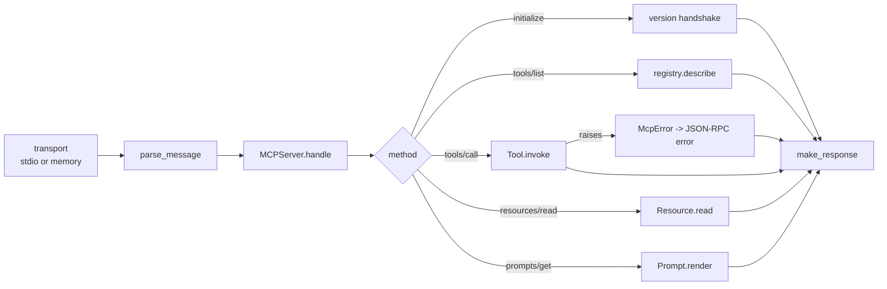

<p align="center">
  <em>Model Context Protocol servers in pure Python. Two protocol versions, zero dependencies.</em>
</p>

<p align="center">
  
  
  
</p>

---

MCP is JSON-RPC over stdio with a capability handshake. Sage implements it on the
standard library — tools, resources, prompts, both transport versions, and an
in-memory transport so you can test the protocol without spawning a process.

## Quick start

```python
from sage import MCPServer, StdioTransport

srv = MCPServer("my-server", "0.1.0")

@srv.tool(description="Add two integers")
def add(a: int, b: int) -> int:
    return a + b

srv.run(StdioTransport())
```

Point Claude Desktop at it:

```json
{
  "mcpServers": {
    "my-server": { "command": "python", "args": ["-m", "my_server"] }
  }
}
```

## Testing without a subprocess

`handle()` takes one raw JSON-RPC string and returns the response, so protocol tests
need no transport at all:

```python
resp = srv.handle('{"jsonrpc":"2.0","id":1,"method":"tools/list","params":{}}')
print(resp)      # tools/list result, includes "add"
```

That is how the test suite runs — 56 tests, no sockets, no child processes.

## Resources and prompts

```python
@srv.resource("file://readme", description="Project readme")
def readme() -> str:
    return open("README.md").read()

@srv.prompt(description="Summarise a file")
def summarise(path: str) -> str:
    return f"Summarise the file at {path} in three sentences."
```

## Protocol surface

| Piece | Role |
|---|---|
| `MCPServer` | registry + dispatcher: `handle(raw)` or `run(transport)` |
| `@srv.tool()` | register a callable; input schema inferred from type hints |
| `srv.resource()` / `srv.prompt()` | register readable resources and prompt templates |
| `StdioTransport` | the real transport, stdin/stdout |
| `InMemoryTransport` | a transport you drive by hand, for integration tests |
| `parse_message` / `make_request` / `make_response` / `make_error` | protocol framing |
| `McpError` | JSON-RPC error with `code`, `message`, `data` |

Supported versions: **2024-11-05** and **2025-03-26**.

## Request path



A tool that raises does not kill the server, and it does not produce a protocol
error either — the failure is reported the way MCP specifies, inside the result:

```json
{"jsonrpc":"2.0","id":5,"result":{
  "content":[{"type":"text","text":"error: kaboom"}],
  "isError":true
}}
```

Protocol-level problems (unknown method, bad params) use the JSON-RPC `error` field
with a numeric code. The distinction matters: a client should surface `isError` to
the user as "the tool failed", but treat a JSON-RPC `error` as "my request was
malformed".

## Install

Copy the `sage/` directory into your project. No `pip install`, no dependencies.

## Tests

```bash
python -m pytest -q
```

## Limitations

- **stdio and in-memory transports only.** No HTTP/SSE — the spec allows it, this
  implementation does not do it.
- **Single-threaded.** `run()` processes one message at a time; a slow tool blocks
  the next request.
- **Input schemas come from type hints.** A parameter typed `Any` or a complex
  nested dict will produce a loose schema; pass `input_schema=` explicitly when the
  inferred one is wrong.
- **No auth.** MCP over stdio inherits the parent process's permissions; there is no
  token layer here.
- **No benchmark numbers.** No throughput or latency measurements are published,
  because none were measured.

## License

MIT
